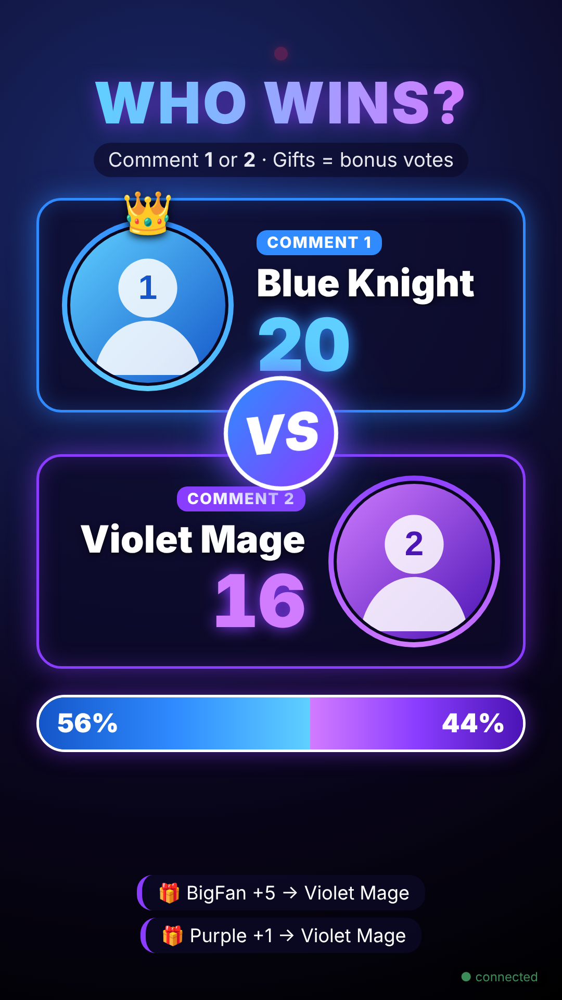
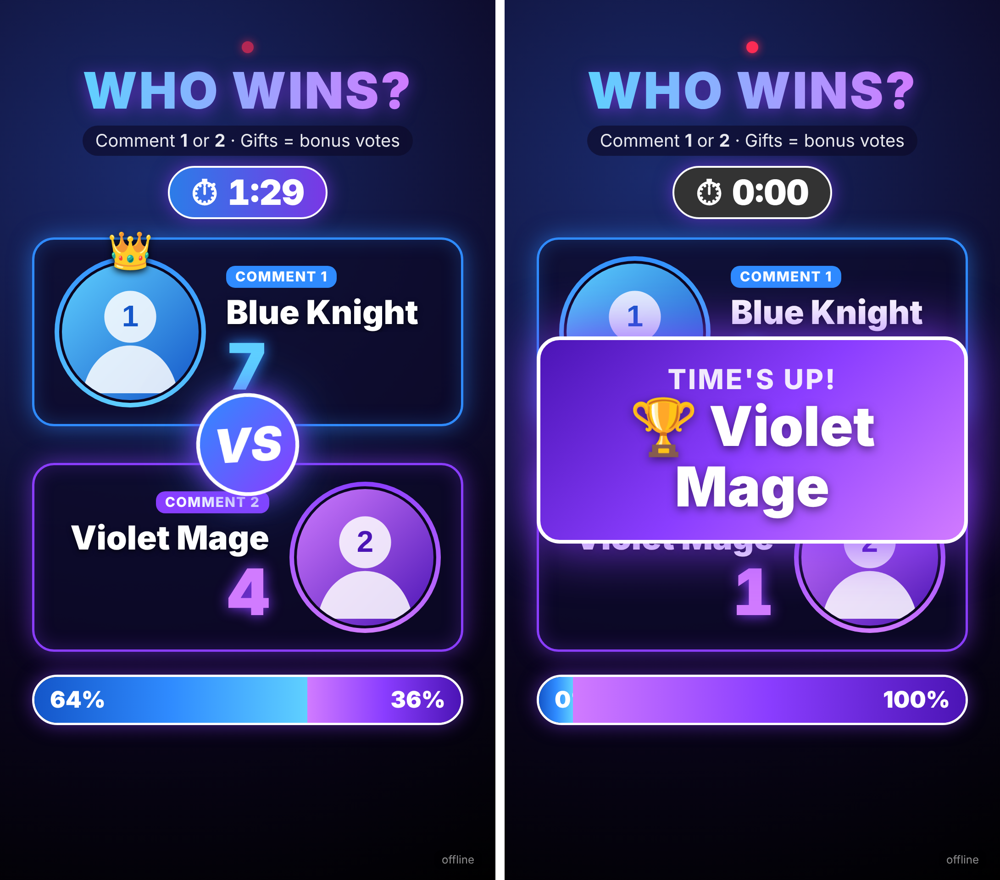

# 🔵 TikTok LIVE Vote Overlay 🟣

A **"Who wins?" voting screen** for your TikTok LIVE.
Viewers comment **1** or **2** to vote, gifts give bonus votes, and a timer announces the winner.




---

## 📖 Contents

**Setup (do once)**
- [Before you start](#-before-you-start)
- [Step 1: Get the overlay link](#step-1-get-the-overlay-link)
- [Step 2: Add your character pictures](#step-2-add-your-character-pictures)
- [Step 3: Customize your link](#step-3-customize-your-link)
- [Step 4: Test it](#step-4-test-it)
- [Step 5: Connect to TikTok](#step-5-connect-to-tiktok)
- [Step 6: Add the overlay to your stream](#step-6-add-the-overlay-to-your-stream)

**Ready-made link**
- [🇮🇱 נתניהו נגד איזנקוט](#-ready-made-נתניהו-נגד-איזנקוט)

**Using it**
- [🎮 Control panel](#-control-panel)
- [✅ Every-stream checklist](#-every-stream-checklist)

**Reference**
- [All settings](#all-settings)
- [Keyboard controls](#keyboard-controls)
- [Troubleshooting](#troubleshooting)
- [Files in this project](#files-in-this-project)

---

## 💡 Before you start

### How it works

The overlay is a web page. It can't see your TikTok LIVE by itself, so a **helper program**
on your computer reads your LIVE and sends the votes to it:

```
Viewers comment & send gifts  →  TikTok  →  Helper program on your PC  →  Overlay on your stream
```

You will choose **one** helper program in Step 5:

| Helper | Good for | Needs |
|---|---|---|
| **TikFinity** ⭐ recommended | Beginners: just install and log in | The free TikFinity app |
| **server.js** (included) | People OK with typing 2 commands | Free Node.js |

### How viewers vote

- Comment **`1`** → +1 vote for the **left (blue)** character
- Comment **`2`** → +1 vote for the **right (purple)** character
  (the comment must be exactly `1` or `2`, or the character's full name)
- With a timer, comments and gifts **only count while a round is running**
  (not before you start, while paused, or after time is up)
- Send a **gift** → +1 point per diamond (coin), for the side they commented
- Or set a **gift per side** (e.g. 🌹 Rose = left, TikTok = right): that gift always counts for that side, even without a comment
- Each viewer can vote once every 2 seconds (stops spam)

### What you need

- ☐ A Windows or Mac computer
- ☐ **TikTok LIVE Studio** or **OBS Studio** for streaming
- ☐ Two character pictures (square PNG or JPG looks best)

---

## 🇮🇱 Ready-made: נתניהו נגד איזנקוט

**Overlay link** (paste into TikTok LIVE Studio → Sources → Link, 1080×1920).
10-minute rounds started from the control panel, Hebrew text.
Gifts: 🌹 Rose (1 coin) and Hand Heart (100 coins) = Netanyahu; TikTok (1 coin) and
Confetti (100 coins) = Eisenkot. Both sides get gifts of exactly the same price. Prices checked against the Israel gift list on
[streamtoearn.io](https://streamtoearn.io/gifts?region=IL). Every coin = 1 point. Other gifts count for the side the viewer commented:

```
https://ricksdo353.github.io/your-username-tiktok-vote-overlay/?left=%D7%91%D7%A0%D7%99%D7%9E%D7%99%D7%9F%20%D7%A0%D7%AA%D7%A0%D7%99%D7%94%D7%95&right=%D7%92%D7%93%D7%99%20%D7%90%D7%99%D7%96%D7%A0%D7%A7%D7%95%D7%98&leftImg=images/netanyahu.jpg&rightImg=images/eisenkot.jpg&q=%D7%9E%D7%99%20%D7%99%D7%A0%D7%A6%D7%97%3F&hint=%D7%9B%D7%AA%D7%91%D7%95%201%20%D7%90%D7%95%202%20%C2%B7%20%D7%9E%D7%AA%D7%A0%D7%95%D7%AA%20%3D%20%D7%A0%D7%A7%D7%95%D7%93%D7%95%D7%AA&timer=10%3A00&autostart=0&giftA=Rose&giftB=TikTok
```

**Control panel link** (open on your phone or in a browser to run the rounds). It creates
a private room for you; follow [Control panel → Set it up](#set-it-up-once) to link it to the overlay:

```
https://ricksdo353.github.io/your-username-tiktok-vote-overlay/control.html?left=%D7%91%D7%A0%D7%99%D7%9E%D7%99%D7%9F%20%D7%A0%D7%AA%D7%A0%D7%99%D7%94%D7%95&right=%D7%92%D7%93%D7%99%20%D7%90%D7%99%D7%96%D7%A0%D7%A7%D7%95%D7%98
```

Photo credits:
- `images/netanyahu.jpg`: Avi Ohayon / Government Press Office of Israel,
  [CC BY-SA 3.0](https://creativecommons.org/licenses/by-sa/3.0/), via
  [Wikimedia Commons](https://commons.wikimedia.org/wiki/File:Benjamin_Netanyahu,_February_2023.jpg).
  Cropped to the face; the cropped version is shared under the same license.
- `images/eisenkot.jpg`: portrait supplied by the repository owner (source not yet confirmed).
  A freely licensed official portrait is available on
  [Wikimedia Commons](https://commons.wikimedia.org/wiki/File:Gadi_Eisenkot_2_(cropped_-_WD).jpg)
  (Yahav Trudler / Gadi Eisenkot spokesperson, CC BY-SA 3.0).

---

# Setup (do once)

## Step 1: Get the overlay link

Your streaming app needs a **link** to the overlay. Pick **one** way:

### ⭐ Way A: Online link (recommended, works everywhere)

1. On this GitHub page, click **⚙️ Settings** (top menu).
2. In the left menu, click **Pages**.
3. Under **Branch**, choose **`main`** and **`/ (root)`**, then click **Save**.
4. Wait about 1 minute and refresh the page.

✅ **Check:** the Pages screen shows *"Your site is live at …"*. Your link is:

```
https://ricksdo353.github.io/your-username-tiktok-vote-overlay/
```

### Way B: Files on your computer

1. On this GitHub page, click the green **`<> Code`** button → **Download ZIP**.
2. Unzip it to an easy place, e.g. `C:\overlay\` (Windows) or your Documents folder (Mac).
3. Drag **`index.html`** into Google Chrome and copy the address from the address bar.

✅ **Check:** your link looks like `file:///C:/overlay/index.html`

> ⚠️ Some streaming apps don't accept `file:///` links. If yours doesn't, use Way A.

---

## Step 2: Add your character pictures

1. Rename your pictures to **`left.png`** and **`right.png`** (or `.jpg`).
2. Put them **next to `index.html`**:
   - **Way A (online):** on this GitHub page, click **Add file → Upload files**, drag
     both pictures in, then click **Commit changes**.
   - **Way B (computer):** copy them into the folder you unzipped.

> No pictures? Skip this step. The overlay shows blue and purple placeholders.

---

## Step 3: Customize your link

You change names, pictures and the timer by **adding text to the end of your link**.

**Here is a ready-to-use example.** Copy it and change the parts in **bold** below:

```
https://ricksdo353.github.io/your-username-tiktok-vote-overlay/?left=Goku&right=Naruto&leftImg=left.png&rightImg=right.png&timer=2:00
```

| Change this… | …to set | Example |
|---|---|---|
| `left=Goku` | Left (blue) name | `left=Messi` |
| `right=Naruto` | Right (purple) name | `right=Ronaldo` |
| `leftImg=left.png` | Left picture file | `leftImg=messi.jpg` |
| `rightImg=right.png` | Right picture file | `rightImg=cr7.jpg` |
| `timer=2:00` | Round length | `timer=30` (30 seconds), `timer=5:00` (5 minutes) |

**Rules:**
- The first setting starts with **`?`**, every next one starts with **`&`**.
- Spaces in names are written as **`%20`** → `left=Blue%20Knight`
- Don't want a timer? Delete `&timer=2:00`.
- Using Way B? Replace the start of the link with your `file:///…/index.html` link.

👉 More options (gift rules, likes, title…) are in [All settings](#all-settings).

---

## Step 4: Test it

1. Add **`&preview=1&demo=1`** to the end of your link and open it in Chrome.
2. You should see votes appearing and the bar moving.
3. Click on the page and try: **`D`** = stop demo, **`R`** = reset, **`1`** / **`2`** = add a vote.

✅ **Check:** names, pictures and timer look the way you want.

> 🔴 **Remove `&preview=1&demo=1` before streaming.** `preview` adds a dark background
> (the real overlay is see-through), and `demo` adds fake votes.

The small text in the bottom-right corner shows the connection status:
- **reconnecting…** = no helper program running yet (normal for now)
- **● connected** (green) = receiving votes from TikTok ✅

---

## Step 5: Connect to TikTok

Choose **one** option.

### ⭐ Option A: TikFinity (recommended)

1. Download TikFinity from **https://tikfinity.zerody.one** and install the **desktop app**.
2. Open it and enter / log in with **your TikTok username**.
3. Start your TikTok LIVE.
4. Refresh the overlay.

✅ **Check:** the overlay's corner says **● connected**.

That's it, you don't need to change your link. The overlay finds TikFinity on its own.

> Still says *reconnecting…*? Make sure the TikFinity **desktop app** is open (not only
> the website), and that its **WebSocket / API** option is turned on in its settings.

### Option B: server.js (included helper)

**First time only:**

1. Install **Node.js** (choose **LTS**) from **https://nodejs.org**.
2. Download this project as a ZIP (see Step 1, Way B) and unzip it.
3. Open a terminal **inside that folder**:
   - **Windows:** open the folder, click the address bar, type **`cmd`**, press **Enter**.
   - **Mac:** right-click the folder → **New Terminal at Folder**.
4. Type this and press Enter:
   ```bash
   npm install
   ```

**Every stream:**

1. Start your TikTok LIVE.
2. In the terminal, type (use your username, without `@`):
   ```bash
   node server.js your_tiktok_username
   ```
3. Add **`&ws=ws://localhost:8080`** to the end of your overlay link.

✅ **Check:** the terminal shows `Connected to @your_tiktok_username's LIVE` and
`Overlay connected`, and the overlay's corner says **● connected**.

> Keep the terminal window open for the whole stream. If it can't connect, it tries again
> every 10 seconds by itself.

---

## Step 6: Add the overlay to your stream

### TikTok LIVE Studio

1. Use the **vertical (portrait)** layout.
2. Under **Sources**, click **+** (Add Source) → choose **Link** (or **Browser**).
3. Paste your link from Step 3.
4. Set size to **1080 × 1920**.
5. Move it **above** your camera in the source list so it shows on top.

### OBS Studio

1. **Settings → Video** → set both resolutions to **1080x1920**.
2. Under **Sources**, click **+** → **Browser** → OK.
3. Paste your link into **URL** (leave *Local file* unticked).
4. Width **1080**, Height **1920** → OK.
5. To stream to TikTok from OBS, put TikTok's **Server URL** and **Stream Key** in
   **Settings → Stream → Custom** (only if your TikTok account has stream-key access).

### Stream to Earn

1. Add a **browser / link / custom overlay** source.
2. Paste your link from Step 3.
3. Keep **TikFinity** or **server.js** running on the same computer. That's where the votes come from.

✅ **Check:** the overlay appears on your stream preview, and the corner says **● connected**.

🎉 **Setup done!**

---

# 🎮 Control panel

`control.html` is a remote control for the overlay. Open it on your **phone** or in any
browser while you're live, and the overlay in TikTok LIVE Studio follows it within a second.

**What it can do:** start / pause / end the round, set the round length (1, 3, 5, 10, 15
minutes or any time you type), add or remove time, add or remove votes by hand, reset,
and turn demo mode on and off.

### Set it up (once)

1. Open the control panel:
   `https://ricksdo353.github.io/your-username-tiktok-vote-overlay/control.html`
2. It creates a private **room name** for you (e.g. `k7m2xq9p`).
3. Paste your overlay link into **"הדבק כאן את קישור ה-overlay שלך"**.
4. Click **"העתק קישור overlay"** and use **that** link in TikTok LIVE Studio
   (it's your link with `&room=…` added).
5. Click **"העתק קישור ללוח הזה"** and open it on your phone, or bookmark it.

✅ **Check:** press **+1** in the panel; the overlay score goes up.

> The overlay and the panel only need the **same room name**. Anyone who knows the
> room name can control your overlay, so keep it private.
> The panel sends commands through the free public service **ntfy.sh**; no account needed.
> The free plan allows about **250 commands per day** from your internet connection. If the
> panel says the daily limit was reached, use the [keyboard](#keyboard-controls) or
> [chat commands](#control-from-your-live-chat-optional) for the rest of the day.

### Control from your LIVE chat (optional)

Add `&host=your_tiktok_username` to the overlay link. Then **only you** can type these in
your own LIVE chat:

| Type in chat | Does |
|---|---|
| `!start` | Start the round |
| `!pause` / `!resume` | Pause / continue |
| `!end` | End now and show the winner |
| `!reset` | Reset votes and timer |
| `!timer 5:00` | Set the round length |

---

# ✅ Every-stream checklist

1. ☐ Go LIVE on TikTok.
2. ☐ Start your helper: open **TikFinity**, *or* run `node server.js your_username`.
3. ☐ Check the overlay corner says **● connected**.
4. ☐ Tell viewers: *"Comment **1** for Goku, **2** for Naruto, gifts are bonus votes!"*
5. ☐ Open the **control panel** and press **▶ התחל סבב** (or the timer starts by itself
   if your link has no `autostart=0`). At **0:00** voting locks and the winner is shown 🏆
6. ☐ Next round: **↺ איפוס** then **▶ התחל סבב** in the control panel.

No control panel? Use the [keyboard](#keyboard-controls) (OBS: right-click the source →
**Interact**) or [chat commands](#control-from-your-live-chat-optional).

---

# Reference

## All settings

Add any of these to your link with `&`.

**Basics**

| Setting | Example | What it does |
|---|---|---|
| `left` | `left=Goku` | Left (blue) name. Default: *Player One* |
| `right` | `right=Naruto` | Right (purple) name. Default: *Player Two* |
| `leftImg` | `leftImg=left.png` | Left picture (file name or `https://` link) |
| `rightImg` | `rightImg=right.png` | Right picture |
| `q` | `q=BEST%20HERO%3F` | Title text. Default: *WHO WINS?* |
| `hint` | `hint=Type%201%20or%202` | Text under the title |
| `leftPos` / `rightPos` | `leftPos=center%2010%25` | Which part of the photo to show (moves the face into the circle). Default: *center 20%* |

**Timer**

| Setting | Example | What it does |
|---|---|---|
| `timer` | `timer=90` or `timer=2:30` | Round length in seconds or minutes:seconds. No setting = no timer |
| `autostart` | `autostart=0` | Don't start the timer automatically (press `T` to start) |

**Votes**

| Setting | Example | What it does |
|---|---|---|
| `giftA` | `giftA=Rose` | Gift(s) that always give points to the left side. Several: `giftA=Rose,Finger%20Heart` |
| `giftB` | `giftB=TikTok` | Gift(s) that always give points to the right side |
| `giftAImg` / `giftBImg` | `giftAImg=images/gifts/heart.png` | Picture for that side's gift. Rose, TikTok, Hand Heart and Confetti already have built-in pictures; other gifts get their picture automatically from the first one sent |
| `giftMult` | `giftMult=2` | Votes per gift diamond. Default: *1* |
| `likes` | `likes=0.1` | Votes per like (`0.1` = 1 vote per 10 likes). Default: *off* |
| `cooldown` | `cooldown=5000` | Wait time between a viewer's comment votes, in milliseconds. Default: *2000* (2 sec) |

**Connection & testing**

| Setting | Example | What it does |
|---|---|---|
| `ws` | `ws=ws://localhost:8080` | Helper address. Default is TikFinity's. Use this one for server.js |
| `room` | `room=k7m2xq9p` | Control-panel room name (same as in `control.html`) |
| `host` | `host=myname` | Your TikTok username, enables `!start` etc. in your chat |
| `preview` | `preview=1` | Dark background for testing |
| `debug` | `debug=1` | Shows every point (and every ignored comment/gift) at the bottom, to see where points come from |
| `demo` | `demo=1` | Fake votes for testing |

**Full example:**
```
…/?left=Goku&right=Naruto&leftImg=left.png&rightImg=right.png&timer=3:00&giftA=Rose%2CHand%20Heart&giftB=TikTok%2CConfetti&likes=0.05
```

## Keyboard controls

| Key | Action |
|---|---|
| `1` / `2` | +1 vote left / right (`Shift` = +10) |
| `R` | Reset votes and timer |
| `T` | Start / restart timer (60 sec if no timer set) |
| `Space` | Pause / resume timer |
| `[` / `]` | Timer −15 sec / +15 sec |
| `Shift` + `[` / `]` | Timer −1 min / +1 min |
| `D` | Demo mode on / off |

Tip: press `[` / `]` **before** pressing `T` to set the round length.

## Troubleshooting

**The corner says "reconnecting…"**
→ Your helper isn't running. Open TikFinity, or run `node server.js your_username`.
→ Using server.js? Make sure your link ends with `&ws=ws://localhost:8080`.

**Terminal says "Connect failed"**
→ Go LIVE first, and check the username (no `@`). It retries automatically.

**"node" or "npm" is not recognized**
→ Install Node.js, then close and reopen the terminal.

**Pictures don't show**
→ The picture must be next to `index.html` and the name must match exactly
(`Left.PNG` ≠ `left.png`).

**Dark background on stream**
→ Remove `preview=1` from your link.

**Score goes up by itself**
→ Those are real viewers: comments `1`/`2` and gifts (🌹 Rose is very common). With a timer,
points only count while a round runs, so press **↺ איפוס** before you start.
→ Add `&debug=1` to the overlay link to see who added every point. Remove it afterwards.
→ Make sure demo mode is off (🧪 in the control panel, or `D`) and the link has no `demo=1`.

**Gifts don't add votes**
→ The viewer must comment `1` or `2` first, or use `giftA` / `giftB` so certain gifts always count.

**Overlay is cut off or too small**
→ Set the source size to 1080 × 1920.

**My changes don't show up**
→ Refresh the source. In OBS: right-click → **Refresh cache of current page**.
On GitHub Pages, changes can take ~1 minute to appear.

## Files in this project

| File | What it is |
|---|---|
| `index.html` | The overlay page |
| `control.html` | Remote control panel (phone / browser) |
| `style.css` | Colors, layout, animations |
| `script.js` | Voting, timer, TikTok connection |
| `images/gifts/` | Gift pictures: Rose, TikTok, Hand Heart, Confetti |
| `server.js` | Optional helper (Option B) |
| `package.json` | List of what `server.js` needs |
